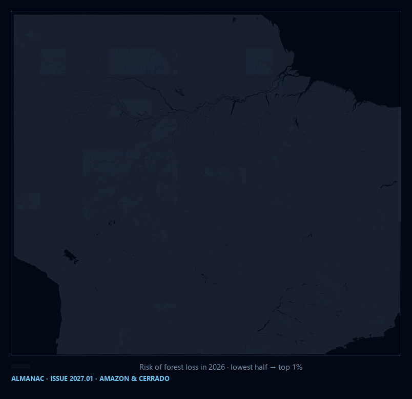
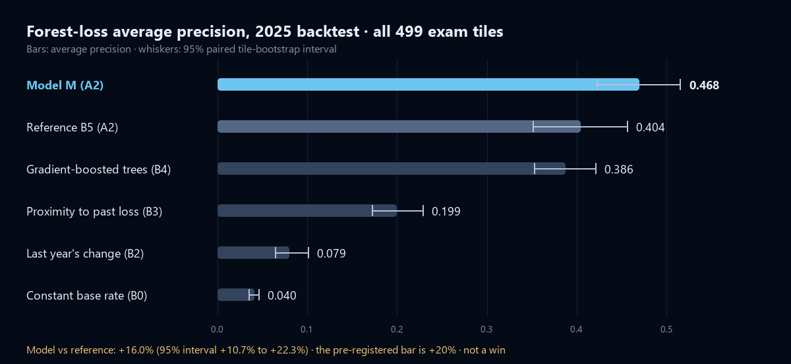
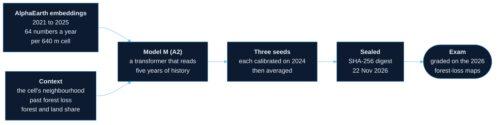
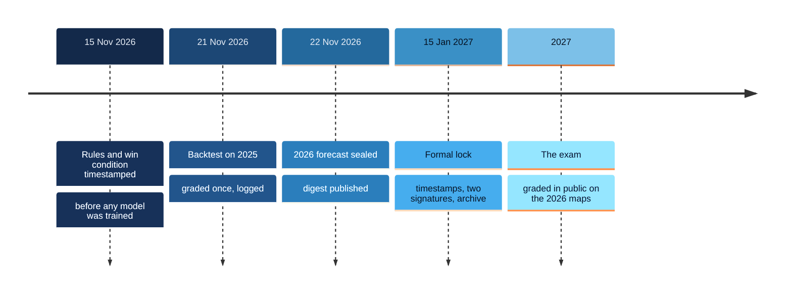

<div align="center">

<a href="https://pranavpanchal1326.github.io/Almanac/"></a>

# Almanac

### Where forest will be lost in 2026, forecast before anyone can know.

A forecast for every 640 m cell of forest across the Amazon and the Cerrado,<br>
made from satellite data up to 2025, **sealed in public**, and graded when the truth arrives. Misses included.

<br>

[](https://pranavpanchal1326.github.io/Almanac/)
[](docs/phase4/package_2027.01_manifest.json)
[](docs/phase2/stage_b_report.md)
[](docs/phase4/STATUS.md)
[](LICENSE)

**[Scorecard](https://pranavpanchal1326.github.io/Almanac/)** &nbsp;·&nbsp;
**[Verify the seal](#-verify-it-yourself)** &nbsp;·&nbsp;
**[The rules](docs/prereg/2027.01.md)** &nbsp;·&nbsp;
**[The release](https://github.com/pranavpanchal1326/Almanac/releases/tag/issue-2027.01-sealed)** &nbsp;·&nbsp;
**[Every run](docs/phase2/STATUS.md)**

</div>

<br>

> [!NOTE]
> **Why this exists.** Most forecasts are judged by the people who make them, after the fact.
> Almanac does the opposite: the rules and the bar for success are written down and timestamped
> before any model is trained, the forecast is sealed with a cryptographic digest before the
> future happens, and the grade is published whether it is good or bad.

<br>

## ◆ The issue at a glance

<table>
<tr>
<td align="center" width="25%"><h2>4,795,484</h2><sub>forest cells forecast,<br>640 m each</sub></td>
<td align="center" width="25%"><h2>499</h2><sub>exam tiles the model<br>never trained on</sub></td>
<td align="center" width="25%"><h2>+16.0%</h2><sub>over the reference on the<br>2025 backtest · bar is +20%</sub></td>
<td align="center" width="25%"><h2><code>bc834b26</code></h2><sub>package digest, public<br>since 22 Nov 2026</sub></td>
</tr>
</table>

| Phase | Question | State |
|---|---|---|
| **0 · Look** | Is yearly change in the satellite embeddings real? | ✅ Passed · [report](docs/phase0/REPORT.md) · [ADR 0001](docs/adr/0001-gate-0.md) |
| **1 · Scoreboard** | A fair exam and simple competitors | ✅ Passed · [status](docs/phase1/STATUS.md) · [ADR 0003](docs/adr/0003-gate-1.md) |
| **2 · Model** | Does a learned model beat the best simple method? | 🟡 **Partial**: best on every part, short of the 20% bar · [ADR 0004](docs/adr/0004-gate-2.md) |
| **4 · Lock** | Is the 2026 forecast sealed in public? | ✅ Sealed 22 Nov 2026 · formal lock 15 Jan 2027 · [label](docs/phase4/LABEL.md) |
| **Exam** | Was it right? | ⏳ When the 2026 forest-loss maps are published (2027) |

<br>

## ◆ The test it has already sat

Before the 2026 forecast was made, the frozen model was scored **once** on 2025, on 499 tiles it
never trained on: a test set and a held-out region in the south-west Amazon. 4,814,716 forest
cells, 192,761 of them lost.

<p align="center"></p>

| Win condition, fixed before training | Result | |
|---|---|:---:|
| Average precision at least **20%** above the reference | +16.0% | ❌ |
| Lower end of the 95% interval above **10%** | +10.7% | ✅ |
| Better on the test tiles **and** on the held-out region, separately | +14.4% · +15.7% | ✅ |

> [!IMPORTANT]
> **Not a win.** The model is the best forecast on every part of the test, but it misses the
> pre-registered bar. The bar was not moved: the 2026 exam is graded against the same three
> conditions, and the reference and every baseline are sealed beside the model.
> [The decision, and the case against it](docs/adr/0004-gate-2.md).

<details>
<summary><b>Full scores by part</b></summary>
<br>

| Forest-loss average precision, 2025 | All 499 tiles | Test (379) | Held-out region (120) |
|---|---:|---:|---:|
| **Model M (A2)** | **0.468** | **0.361** | **0.673** |
| Reference: same network without neighbours (B5, A2) | 0.404 | 0.315 | 0.582 |
| Gradient-boosted trees (B4) | 0.386 | 0.315 | 0.549 |
| Proximity to past loss (B3) | 0.199 | 0.160 | 0.283 |
| Base rate | 0.040 | 0.035 | 0.051 |

The 95% interval of the improvement is +10.7% to +22.3% (paired tile bootstrap, 2,000 draws).
Re-graded by separate code that shares nothing with the grader: 64 of 64 values matched
([reproduction](docs/phase2/stage_b_reproduction.md)). Full tables:
[stage B report](docs/phase2/stage_b_report.md).

</details>

<br>

## ◆ How the forecast is made



The model is trained on 800 tiles that touch no exam tile. The **reference** is the same network
without the neighbourhood, the best of six candidates on the 2024 validation year, so the bar is
the strongest simple competitor, chosen before the model's backtest.

<br>

## ◆ The timeline



<br>

## ◆ Verify it yourself

The package is plain `.npy` layers, a tile list and a canonical manifest. Its digest is the
SHA-256 of the manifest, [committed in public](docs/phase4/package_2027.01_manifest.json) before
any 2026 truth existed. The verifier needs only Python and NumPy, and imports nothing else from
this repository.

```bash
tar -xf almanac-2027.01.tar
python tools/verify_issue.py almanac-2027.01 \
  --digest bc834b2691f0f1c9fdee05a0c0fbae87958efe3a8d3e670aeff113f9b02b7949
```

It checks every file's SHA-256, the digest, each layer's type, shape and range, and that the
headline and reference cover every cell the baselines forecast. It prints `VERIFIED` or the checks
that failed. The rules themselves are timestamped by FreeTSA and DigiCert and anchored in Bitcoin:
[how to verify the timestamps](docs/prereg/proofs/README.md). Every read of the test truth is
logged in [test_touch_log.jsonl](docs/phase1/test_touch_log.jsonl).

<br>

## ◆ What is weak, said plainly

- **The probabilities run high.** On 2025 the model forecast more loss than happened in every
  tenth of its forecasts; read the map as a ranking of risk first.
- **Validation disagreed.** On the 2024 validation year the model was 4.6% *below* the reference,
  on a small check of 146 tiles.
- **The test data were read twice.** Once for the graded backtest and once, against the protocol,
  for an independent re-grade of the same frozen forecasts. Nothing changed; both reads are logged
  and disclosed in [ADR 0004](docs/adr/0004-gate-2.md).
- **Narrow by design.** One region, one kind of event, one year ahead.

<br>

## ◆ The exam, in full

<details>
<summary><b>Pre-registration 2027.01: task, tiles, reference and win condition</b></summary>
<br>

- **Task:** forest loss of at least 2.5% of a cell (about 1 ha) in 2026, among cells with forest.
  Truth: Global Forest Change, an independent yearly map.
- **Exam tiles:** a test set and a held-out region (south-west Amazon) never used in training.
- **Reference:** the best on validation 2024 among the simple baselines and the no-neighbour
  network B5 ([amendment 2](docs/prereg/2027.01.amendment-2.md), section 4): B5 (A2).
- **Win:** average precision at least 20% above the reference, the lower end of a 95% tile-bootstrap
  interval above 10%, and better than the reference on the test tiles and on the held-out region
  separately.
- **Text and proofs:** [docs/prereg/2027.01.md](docs/prereg/2027.01.md), timestamped on
  2026-11-15 by FreeTSA and DigiCert (RFC 3161) and OpenTimestamps; amendments 1 and 2 timestamped
  before the runs they govern and anchored in Bitcoin blocks 976,013 and 976,246.
  [How to verify](docs/prereg/proofs/README.md).

The full plan is in [BLUEPRINT.md](BLUEPRINT.md); the regional plan to the first lock is in
[docs/phase1/PLAN.md](docs/phase1/PLAN.md).

</details>

<details>
<summary><b>The scorecard page</b></summary>
<br>

**Live: https://pranavpanchal1326.github.io/Almanac/** · `site/index.html`, the issue's public page:
the Earth from orbit descending on the Amazon, the interactive 2026 map, the backtest, the win
condition, the weaknesses, the digest and every read of the test truth. It is generated from the
committed records by `python tools/phase4/build_site.py`, and the art in this README by
`python tools/phase4/readme_art.py`; no number in either is typed by hand.

</details>

<br>

## ◆ Run it

<details>
<summary><b>Set up and check</b></summary>
<br>

Needs [uv](https://docs.astral.sh/uv/) and, for training, an NVIDIA GPU with a current driver.

```bash
uv sync --extra train
```

```bash
uv run --extra train almanac versions
```

Without `--extra train` everything except PyTorch is installed, which is enough for Phases 0 and 1.

```bash
uv run pytest
```

```bash
uv run pytest -m network
```

The first runs offline. The second reads one real block from the supplier and confirms the reader
still matches the supplier's north-up sidecar file.

</details>

<details>
<summary><b>Reproduce every phase</b></summary>
<br>

Data is kept outside the repository, under `D:\almanac-data` (about 17 GB for the region, plus 2.5 GB for Phase 0). Every
data file the exam depends on is listed with its SHA-256 in
[configs/manifests/amazon_cerrado_v1.sha256](configs/manifests/amazon_cerrado_v1.sha256).

**Phase 1** (Amazon + Cerrado, 2,020 tiles):

| Step | Command | Task |
|---|---|---|
| 1 | `uv run almanac stream level --out D:/almanac-data/summaries --keep D:/almanac-data/embeddings --region configs/regions/amazon_cerrado.json` | 1.1–1.3 |
| 2 | `uv run python tools/phase1/build_labels.py configs/regions/amazon_cerrado.json` | 1.4 |
| 3 | `uv run python tools/phase1/build_forest.py configs/splits/amazon_cerrado_v1.csv` | 1.4 |
| 4 | `uv run python tools/phase1/make_split.py configs/splits/amazon_cerrado_v1.json` | 1.7 |
| 5 | `uv run python tools/phase1/threshold_study.py configs/splits/amazon_cerrado_v1.csv` | 1.8 |
| 6 | `uv run python tools/phase1/baseline_report.py configs/baselines/amazon_cerrado_v1.json` | 1.9–1.11 (about 4 hours) |
| 7 | `uv run python tools/phase1/compare_reports.py <report_a.json> <report_b.json>` | reproduction check |

Steps 2 and 3 need the Global Forest Change v1.13 `lossyear`, `datamask` and `treecover2000`
rasters for the region in `D:/almanac-data/labels/gfc`.

**Phase 2** (model; one NVIDIA GPU with 8 GB, about 10 hours per run):

| Step | Command | Task |
|---|---|---|
| 1 | `uv run --extra train python tools/phase2/build_store.py configs/splits/amazon_cerrado_v1.csv` | 2.1 (training store) |
| 2 | `bash tools/phase2/run_stage_a.sh list stage_a2_b5 stage_a2_m_a stage_a2_m_a_s2 stage_a2_m_a_s3` | 2.3–2.4 (supervised runs; configs in `configs/model`) |
| 3 | `uv run --extra train python tools/phase2/ensemble.py D:/almanac-data/runs/stage_a2_m_a_s1 D:/almanac-data/runs/stage_a2_m_a_s2 D:/almanac-data/runs/stage_a2_m_a_s3 --out docs/phase2/ensemble_m_a` | 2.6 (calibration, ensemble) |
| 4 | `uv run --extra train python tools/phase2/stage_b.py build OUT [--dry]` | 2.7 (package for the backtest) |
| 5 | `uv run --extra train python tools/phase2/stage_b.py grade OUT --dry` | rehearsal on validation; the real grade is a single logged read of the test truth and is already done |

**Phase 4** (the 2026 forecast):

| Step | Command | Task |
|---|---|---|
| 1 | `uv run python tools/phase4/forecast_baselines.py configs/baselines/amazon_cerrado_v1.json D:/almanac-data/packages/2027.01` | 4.3 (baselines B0–B4 for 2026) |
| 2 | `uv run --extra train python tools/phase4/forecast_exam.py` | 4.2 (model and reference for 2026, from the frozen weights) |
| 3 | `uv run python tools/phase4/archive_package.py PACKAGE OUT.tar` | release archive (reproducible bytes) |
| 4 | `uv run python tools/phase4/build_site.py` | the scorecard page in `site/` |
| 5 | `uv run python tools/phase4/readme_art.py` | the art in this README, in `docs/media/` |

Frozen weights are listed with their SHA-256 in [docs/phase2/STATUS.md](docs/phase2/STATUS.md#frozen-weights).

**Phase 0:** `uv run almanac index sync`, then the scripts in `tools/phase0` (sites in
`configs/phase0/sites.json`); details in the Phase 0 report.

</details>

<details>
<summary><b>Repository layout</b></summary>
<br>

| Path | Contents |
|---|---|
| `src/almanac/io` | Supplier index queries; block reader; HTTP range client |
| `src/almanac/grid` | Tile and block identifiers |
| `src/almanac/quality` | Decoding, vector length, change |
| `src/almanac/data` | Streaming pass, labels, split, change rules, per-tile data cube |
| `src/almanac/baselines` | Features available at issue time; baselines B0–B4 |
| `src/almanac/evaluate` | Metrics and the paired tile bootstrap |
| `src/almanac/model` | Training store, sampler, network, inference |
| `src/almanac/registry` | Forecast packages: layers, canonical manifest, digest |
| `src/almanac/cli` | The `almanac` command |
| `tools/phase0` … `tools/phase5` | Scripts that produce the evidence (training, stage B, its reproduction, the 2026 forecasts, the grader, the site and README art); nothing in `src` imports them |
| `tools/verify_issue.py` | Stand-alone package verifier (Python and NumPy only) |
| `tools/prereg` | Bundle and timestamp tools for pre-registrations |
| `configs` | Region, split, threshold, baseline and data-manifest files |
| `tests` | Unit, property, golden and live-read tests |
| `docs` | Phase reports, decision records, pre-registration, proofs and media |

</details>

<br>

## ◆ Cite, licence and attribution

If you use the forecast, the method or the scorecard, cite the repository; GitHub's
**Cite this repository** button reads [CITATION.cff](CITATION.cff).

Code and documentation: [Apache License 2.0](LICENSE). Third-party data, figures and timestamp
certificates keep their own terms; see [NOTICE](NOTICE).

The AlphaEarth Foundations Satellite Embedding dataset is produced by Google and Google DeepMind.
It is used under CC-BY 4.0, read from the Source Cooperative mirror. Forest labels: Hansen, M. C.
et al. 2013, "High-Resolution Global Maps of 21st-Century Forest Cover Change", Science 342:
850–853; Global Forest Change 2000–2025 v1.13, University of Maryland, under CC-BY 4.0. Figures in
`docs/phase0` contain modified Copernicus Sentinel data.

<br>

<div align="center">
<sub><b>Graded in public. Misses included.</b></sub>
</div>
